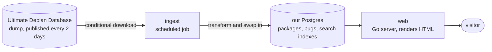

# `sourcesli.st`

Another way to browse Debian packages and bug reports, and to pick a Debian ISO to download.

Source: [github.com/fnune/sourcesli.st](https://github.com/fnune/sourcesli.st). Nothing is deployed yet, so the only way to see it is to [run it locally](CONTRIBUTING.md).

## What you can do with it

**Pick an ISO.** Debian publishes a lot of images, across releases, installer types, desktops, and firmware options. The image list groups them by hardware. Each entry says what you get and links to the current point release, with its checksum and signature.

**Search packages.** One box searches binary and source packages in every suite we carry. It suggests names as you type, and when nothing matches it offers near names instead of an empty page.

**Read a package page.** Versions per architecture, dependencies, the source package, the maintainer, and the description, with links to the Debian pages they came from.

**See a package's bugs.** Bugs are on the package page, filtered by status and severity. Opening one takes you to the Debian Bug Tracking System, which has the live record and the full message log.

Every page works with JavaScript turned off. No accounts, no comments, no ads.

## How it works

Debian already collects this data. The [Ultimate Debian Database](https://wiki.debian.org/UltimateDebianDatabase) pulls the archive indices, bug reports, popcon, and upload history into one Postgres database, and publishes a dump of it every two days for bulk users like us.

We copy that dump into our own database on a schedule, and the website only reads from our copy.

So a visit to the site never causes a request to a Debian service. Debian's hardware and bandwidth are paid for by donations and run by volunteers, so our load on it must not grow with our traffic. If the dump has not changed since last time, ingest downloads nothing and rebuilds nothing.

The cost is that our data is only as new as the last dump. We would rather be a bit behind than add load upstream, and the footer on every page says when the data was last updated.

## What it does not do

- It does not replace [tracker.debian.org](https://tracker.debian.org), [sources.debian.org](https://sources.debian.org), or the BTS. It links to them.
- No source-code browsing or code search. [sources.debian.org](https://sources.debian.org) and [codesearch.debian.net](https://codesearch.debian.net) already do that well.
- No package downloads and no mirroring of the archive. Metadata only.
- Debian only, no derivatives.

## Contributing

[CONTRIBUTING.md](CONTRIBUTING.md) covers the architecture, how to run the site locally, and how it is built. [engineering/README.md](engineering/README.md) has the rules the code follows. Read that one first.

## Licence and attribution

The data on this site comes from Debian and stays under its original licences. Every page that shows upstream content links back to the Debian page it came from. `sourcesli.st` is not affiliated with the Debian Project.
