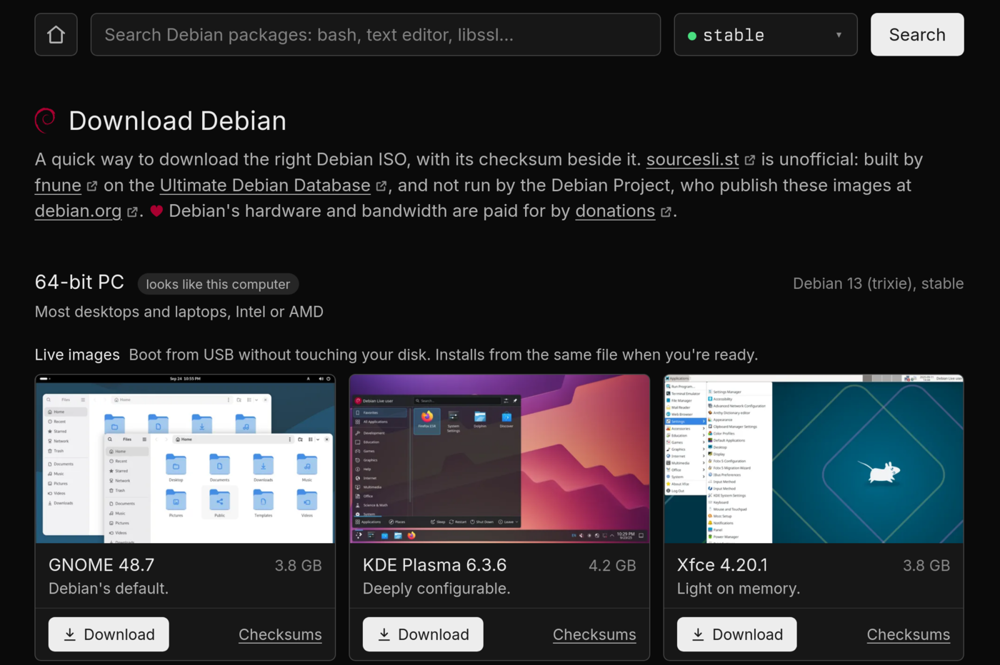
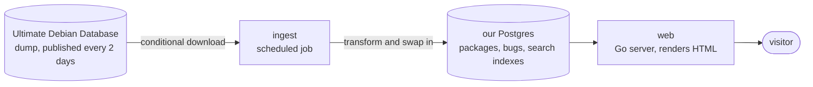

# `sourcesli.st`

Another way to browse Debian packages and bug reports, and to pick the right Debian ISO to download.

Source: [github.com/fnune/sourcesli.st](https://github.com/fnune/sourcesli.st). Nothing is deployed yet, so the only way to see it is to [run it locally](CONTRIBUTING.md).

## What you can do with it

**Pick an ISO.** Debian publishes many images, and the download pages assume you already know how releases, installers, and media are organised. The image list groups them by hardware and tells you, for each one, what you get and what to check it against: a direct link to the current point release, plus its checksum and signature. This is the part of the site with no good existing alternative, so it gets the most attention.

**Search packages.** One search box over binary and source packages in every suite we carry. It suggests names as you type, and when a query matches nothing it offers near names instead of an empty page.

**Read a package page.** Versions per architecture, dependencies, the source package, the maintainer, and the description, with links back to the authoritative Debian pages.

**See a package's bugs.** Bugs appear on the package page itself, filterable by status and severity, so you do not need a second lookup somewhere else. Opening a bug takes you to the Debian Bug Tracking System, which holds the live record and the full message log.

Every page works with JavaScript turned off. There are no accounts, no comments, and no ads.

## How it works

Debian already collects the data this site needs. The [Ultimate Debian Database](https://wiki.debian.org/UltimateDebianDatabase) pulls the archive indices, bug reports, popcon, and upload history into one Postgres database, and publishes a dump of it every two days for bulk users like us.

We copy that dump into our own database on a schedule, and the website only ever reads from our copy.

The rule this shape exists to keep: a visit to the site never causes a request to a Debian service. Debian's infrastructure is paid for by volunteers, so our load on it stays the same whether the site gets ten visitors a day or ten million. If the dump has not changed since last time, ingest downloads nothing and rebuilds nothing.

The trade is that the data is as old as the last dump. We prefer showing slightly stale data over adding load upstream, and the footer on every page says when the data was last updated.

[Decision record 0001](engineering/decisions/0001-source-bulk-data-from-udd.md) explains why the dump beats every other source of this data.

## What it does not do

- It does not replace [tracker.debian.org](https://tracker.debian.org), [sources.debian.org](https://sources.debian.org), or the BTS. It links to them.
- No source-code browsing or code search. [sources.debian.org](https://sources.debian.org) and [codesearch.debian.net](https://codesearch.debian.net) already do that well.
- No package downloads and no mirroring of the archive. Metadata only.
- Debian only, no derivatives.

[REQUIREMENTS.md](REQUIREMENTS.md) is the full specification.

## Contributing

[CONTRIBUTING.md](CONTRIBUTING.md) covers the architecture, how to run the site locally, and how it is built and deployed. [engineering/README.md](engineering/README.md) has the principles and conventions this repository holds itself to. Read that one first.

## Licence and attribution

The data this site presents comes from Debian and stays under its original licences. Every page that reproduces upstream content links back to the authoritative Debian page. `sourcesli.st` is not affiliated with the Debian Project.
